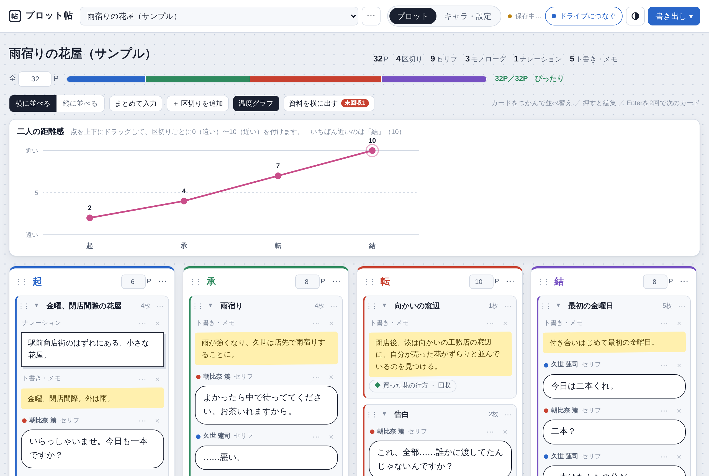

# プロット帖

漫画のプロットを、セリフやモノローグのカードで組み立てるアプリです。
カードを並べ替えながら話の流れを考え、できたセリフはCLIP STUDIO PAINTのストーリーエディターにそのまま流し込めます。
スマホ・タブレット・PCのどれでも使えます。

**使いかたは、アプリの中の「⋯」→「使いかた」から読めます**(`help.html`)。
画面の写真付きで、カードの書き方から書き出し・同期まで説明しています。

---

## このアプリを置く人へ

### GitHub Pages に公開する

1. GitHubで新しいリポジトリを作ります(例: `plotcho`、Public)。
2. このフォルダの**中身**をリポジトリの直下にアップロードします。`index.html` がトップに直接並んでいれば成功です。
3. 「Settings」→「Pages」で、Source を **Deploy from a branch**、Branch を **main** と **/ (root)** にして「Save」を押します。
4. 1〜2分で `https://(ユーザー名).github.io/plotcho/` から開けるようになります。

### Googleドライブ同期を使う

`config.js` の `googleClientId` に、Google CloudのOAuthクライアントID(種類: ウェブ アプリケーション、スコープ: `drive.appdata`)を入れます。
コマ帖と同じ `github.io` から開くなら、コマ帖と同じクライアントIDを使えます。
ログインできるのは、Google Cloudの「テストユーザー」に追加したGoogleアカウントだけです。

### 更新するとき

- 直したファイルを、リポジトリの同じ場所に上げ直します。
- `sw.js` の `VERSION` の数字を上げてください。開いている人に「新しい版があります」と表示されます。
- 使いかたを直すときは `docs/help.md` を書き換えて、`python docs/build-help.py` で `help.html` を作り直します(Python と `pip install markdown` が必要です)。

### ファイル

| ファイル | 中身 |
| --- | --- |
| `index.html` | アプリ本体 |
| `help.html` | 使いかたのページ(`docs/help.md` から作ったもの) |
| `docs/` | 使いかたの元の文章・画面の写真・ページを作るスクリプト |
| `drive.js` | Googleドライブとの通信 |
| `config.js` | クライアントIDの設定 |
| `sw.js` | オフラインでも開けるようにする仕組み |
| `manifest.webmanifest`・`icons/` | ホーム画面に置いたときの名前とアイコン |
| `vendor/` | 並べ替え・画像書き出し・PDF書き出しのライブラリ |
